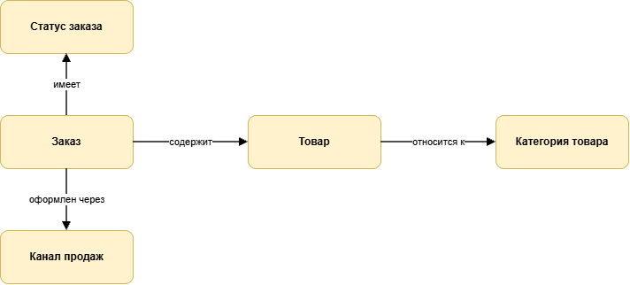
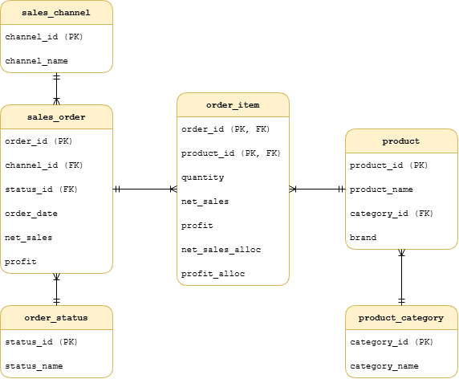
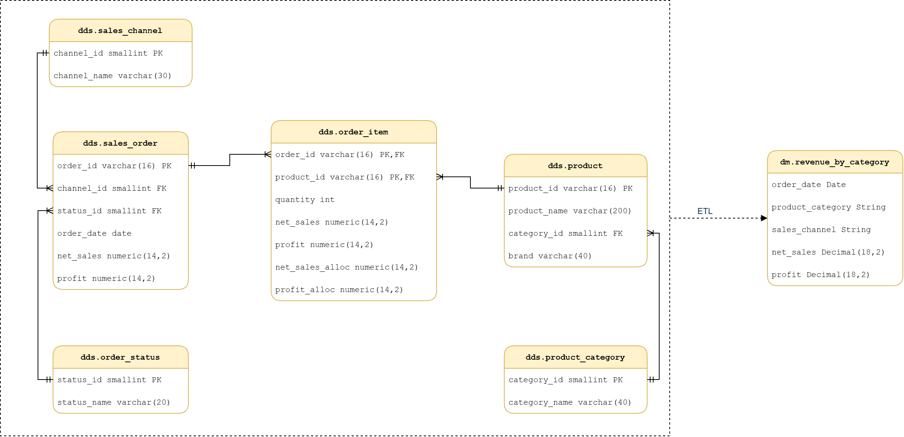
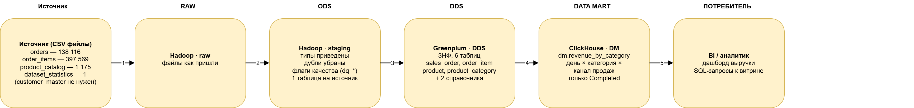
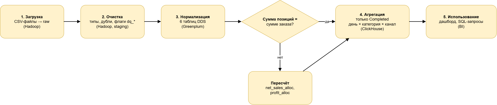

# Проектирование хранилища данных: витрина выручки по категориям товаров

## 1. Задача и источник

Источник - данные интернет-магазина за 2021-2025 годы: файлы CSV.

| Таблица | Строк | Ключ | Что берём |
| --- | --- | --- | --- |
| orders | 138 116 | order_id | статус, канал продаж, дата, выручка и прибыль заказа |
| order_items | 397 569 | order_id + product_id | товары в заказе, количество, суммы по позициям |
| product_catalog | 1 175 | product_id | название, бренд, категория товара |
| dataset_statistics | 1 | отсутствует | контрольные суммы для сверки |
| customer_master | 25 000 | customer_id | не берём, для этой задачи не нужна |

**Бизнес-задача:** анализировать выручку и прибыль по категориям товаров.

## 2. Модели данных

### 2.1 Концептуальная



### 2.2 Логическая



- Категория вынесена из товара в отдельную таблицу, канал продаж и статус - справочники, чтобы значения не повторялись в каждой строке.
- Заказ и позиции заказа хранятся отдельно.
- `net_sales_alloc` и `profit_alloc` - суммы позиции, пересчитанные под суммы заказа.

### 2.3 Физическая



## 3. Архитектура и слои



| Слой | Система | Что хранится | Зачем |
| --- | --- | --- | --- |
| raw | Hadoop | файлы источника без изменений | можно пересчитать всё ниже, если поменяется логика |
| ODS | Hadoop | приведённые типы, без дублей, с флагами качества | чистая копия источника |
| DDS | Greenplum | нормализованная модель | единая согласованная версия данных |
| data mart | ClickHouse | одна готовая к анализу таблица | быстрые отчёты |

## 4. Путь данных

### 4.1 Этапы процесса



| Этап | Входные данные | Выходные данные | Система | Назначение |
| --- | --- | --- | --- | --- |
| 1. Загрузка | файлы CSV | файлы в raw | Hadoop | сохранить источник как есть |
| 2. Очистка | raw-файлы | staging-таблицы с типами и флагами `dq_*` | Hadoop | привести типы, убрать дубли |
| 3. Нормализация | staging | 6 таблиц DDS, `net_sales_alloc`, `profit_alloc` | Greenplum | собрать согласованную модель |
| 4. Агрегация | DDS | `dm.revenue_by_category` | ClickHouse | посчитать выручку и прибыль по срезам |
| 5. Использование | витрина | дашборд, запросы | BI | показать результат аналитикам |

### 4.2 Маппинг таблиц

| Источник | Приёмник | Что происходит |
| --- | --- | --- |
| orders | `dds.sales_order` | дата из строки в `date`; канал и статус заменены ключами справочников |
| orders | `dds.sales_channel`, `dds.order_status` | выбраны уникальные значения |
| order_items | `dds.order_item` | строки с одним товаром в заказе объединены; добавлены `net_sales_alloc`, `profit_alloc` |
| product_catalog | `dds.product`, `dds.product_category` | категория вынесена в отдельную таблицу |
| DDS-таблицы | `dm.revenue_by_category` | соединение, фильтр по статусу, суммирование по дню, категории и каналу |

### 4.3 Трансформации

1. **Типизация.** Дата заказа приходит строкой, в staging она становится датой, суммы - числами с двумя знаками.
2. **Дубли.** В `orders` дублей по `order_id` нет (138 116 уникальных заказов). В `order_items` пара `order_id + product_id` повторяется в 87 строках (86 заказов): один товар записан двумя строками с разным количеством. Это не копии, поэтому такие строки объединяем в одну (суммируем количество, выручку и прибыль). Итоги не меняются, а ключ позиции остаётся уникальным.
3. **Выручка - только выполненные заказы.** В данных четыре статуса: Completed 113 559, Returned 9 462, Cancelled 8 398, Pending 6 697. Выручкой считаем только Completed.
4. **Расхождение сумм.** У 11 226 заказов (8,1 %) сумма по позициям не совпадает с суммой в заказе. Итог по позициям 192,40 млн, по заказам 177,13 млн, и именно сумма по заказам совпадает с контрольным итогом из `dataset_statistics`. Поэтому суммы заказа считаются верными, а позиции пересчитываются пропорционально их доле в заказе:
   `net_sales_alloc = net_sales_заказа × net_sales_позиции / Σ net_sales_позиций заказа`; прибыль (`profit_alloc`) распределяется по той же доле.
   После пересчёта итоги снова сходятся: выручка 177 134 263,74, прибыль 76 146 395,76.
5. **Денормализация.** В витрине позиция, заказ, товар, категория и канал собраны в одну таблицу.

## 5. Витрина `dm.revenue_by_category`

| Параметр | Значение |
| --- | --- |
| Назначение | анализ выручки и прибыли по категориям товаров |
| Бизнес-ценность | видно, какие категории дают основную выручку и где маржа ниже |
| Гранулярность | день × категория × канал продаж |
| Метрики | `net_sales` (выручка), `profit` (прибыль) |
| Производная метрика | маржа = Σ profit / Σ net_sales |
| Измерения | дата, категория товара, канал продаж |
| Глубина хранения | весь период, 2021–2025 |
| Частота обновления | раз в сутки, ночью |
| Способ обновления | инкремент: каждую ночь удаляем данные за последние 60 дней и загружаем заново |

Почему пересчитываются последние 60 дней, а не только новый день: статус заказа может поменяться уже после создания, и старые строки витрины устареют. Маржа в таблице не хранится, потому что её нельзя складывать по срезам, она считается в BI как отношение сумм.

Запрос для загрузки витрины:

```sql
SELECT
    o.order_date,
    c.category_name  AS product_category,
    ch.channel_name  AS sales_channel,
    SUM(i.net_sales_alloc) AS net_sales,
    SUM(i.profit_alloc)    AS profit
FROM order_item i
JOIN sales_order o      ON o.order_id = i.order_id
JOIN product p          ON p.product_id = i.product_id
JOIN product_category c ON c.category_id = p.category_id
JOIN sales_channel ch   ON ch.channel_id = o.channel_id
JOIN order_status s     ON s.status_id = o.status_id
WHERE s.status_name = 'Completed'
GROUP BY o.order_date, c.category_name, ch.channel_name
```

## 6. Требования к витрине

### 6.1 Введение

Данные о продажах лежат в сырых таблицах, и чтобы увидеть выручку по категориям, нужно вручную соединять заказы, позиции и каталог. Витрина даёт готовую таблицу для отчётов по выручке и прибыли.

### 6.2 Бизнес-требования

- **BR1.** Видеть выручку и прибыль по категориям товаров за любой период.
- **BR2.** Сравнивать категории по марже.
- **BR3.** Разбивать результаты по каналам продаж.
- **BR4.** Итоги витрины должны сходиться с исходными данными по выполненным заказам.

### 6.3 Функциональные требования (user story)

| № | История | Критерий приёмки |
| --- | --- | --- |
| US1 | Как аналитик, я хочу видеть выручку по категориям за месяц, чтобы понимать, какие категории основные | сумма по категориям за месяц равна выручке выполненных заказов за этот месяц |
| US2 | Как менеджер категории, я хочу видеть маржу по своей категории, чтобы понимать, насколько она прибыльна | маржа считается как Σ profit / Σ net_sales |
| US3 | Как менеджер по каналам, я хочу сравнить выручку по каналам продаж, чтобы видеть, где продаётся больше | можно отфильтровать и сгруппировать по каналу продаж |
| US4 | Как финансовый аналитик, я хочу, чтобы итоги сходились с отчётностью, чтобы цифрам можно было доверять | сумма по всем датам равна 144 195 838,50 |

### 6.4 Использование витрины

Витрина подключается к BI и используется для дашборда по выручке и марже категорий товаров с разбивкой по дням, месяцам и каналам продаж. Для разовых задач к ней можно обращаться SQL-запросом.